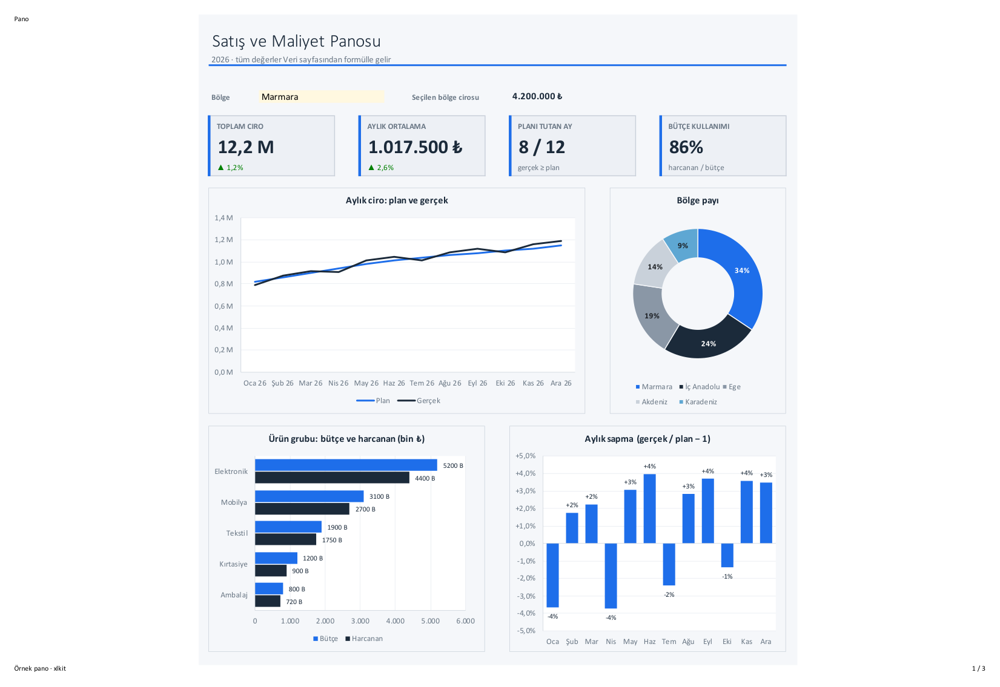
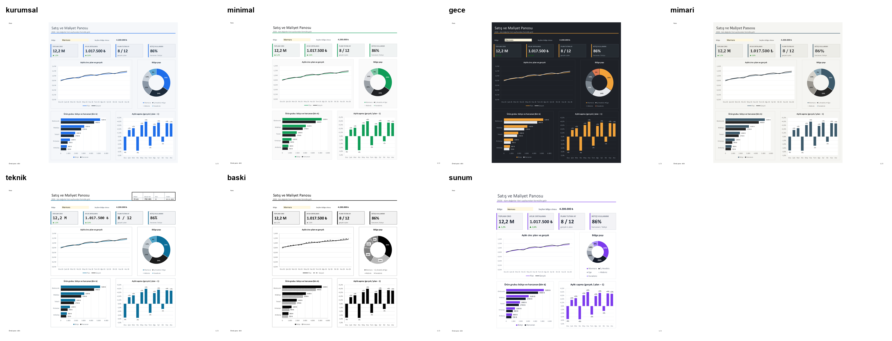

# Claude Excel Skills

AI kod araçları için üç skill'lik bir set: Excel'de profesyonel **panolar**, **grafikler** ve **tutarlı tasarım**
üretir. Ortak bir Python kütüphanesi (`xlkit`) ve çalışan bir pano şablonu içerir. Her kural Microsoft
Excel'de PDF'e alınıp görüntüden doğrulanmıştır.

*A set of three agent skills (Claude Code, Codex, Gemini/Antigravity, OpenCode, Qoder, MLX-Serve) for building professional Excel dashboards, charts and styled workbooks
with openpyxl. Turkish-first documentation; every rule was verified by rendering in Microsoft Excel.*



## İçindekiler

- [Skill'ler](#skiller)
- [Gereksinimler](#gereksinimler)
- [Kurulum](#kurulum)
- [Kullanım](#kullanım)
- [Örnek pano](#örnek-pano)
- [Örnek dosyalar](#örnek-dosyalar)
- [Dosya yapısı](#dosya-yapısı)
- [Bilinen sınırlar](#bilinen-sınırlar)
- [1.0.1'den geçiş](#101den-geçiş)
- [Lisans](#lisans)

## Skill'ler

| Skill | Ne zaman devreye girer | İçerik |
|---|---|---|
| [`excel-design-system`](skills/excel-design-system/SKILL.md) | Tema, renk, yazı, tablo, KPI kartı, Türkçe sayı/tarih biçimi, baskı | Tasarım kuralları, tema tokenları, `xlkit.py` |
| [`excel-charts`](skills/excel-charts/SKILL.md) | Grafik ekleme, seçme, renklendirme, etiket ve eksen biçimi, yerleşim | Grafik türü seçimi, tek tasarım kuralı, 14 ölçülmüş openpyxl tuzağı |
| [`excel-dashboard`](skills/excel-dashboard/SKILL.md) | Yönetim paneli, KPI sayfası, filtreli özet | Izgara, KPI kartı, filtre, gezinme, çalışan şablon |

Skill'ler birbirine dayanır: `excel-charts` ve `excel-dashboard`, `excel-design-system` içindeki
`xlkit.py` kütüphanesini kullanır.

## Gereksinimler

- Skill okuyabilen bir AI aracı: Claude Code / Claude Desktop, Codex, Antigravity (Gemini), OpenCode, Qoder,
  MLX-Serve.
- Python 3.10+. Paketler: `openpyxl` (zorunlu), `pymupdf` ve `pillow` (önizleme). [uv](https://docs.astral.sh/uv/)
  varsa paketler çalışma anında yüklenir; yoksa bir kez `python3 -m pip install --user openpyxl pymupdf pillow`.
- Hesaplatma ve görsel denetim için bir motor (isteğe bağlı; olmadan dosya yine üretilir):

| Motor | Sistem | Not |
|---|---|---|
| Microsoft Excel | macOS | AppleScript; Excel sandbox'ı yeni dosya/klasör için bir kez izin ister |
| Microsoft Excel | Windows | COM; `python -m pip install --user pywin32` |
| LibreOffice | macOS, Windows, Linux | Ücretsiz; önizleme için. Excel'den küçük görünüm farkları olabilir |

Ortamınızı denetlemek için: `python3 skills/excel-design-system/scripts/ortam.py`

## Kurulum

Depoyu indirin ve kurulum betiğini çalıştırın. Betik skill'leri bilgisayarınızdaki her AI aracının skill
klasörüne **bağlantı** olarak kurar (tek kaynak; `git pull` her araca anında yansır). Yalnız var olan araç
klasörlerine dokunur, aynı adda başka bir skill varsa üzerine yazmaz.

```bash
git clone https://github.com/hazarvolga/claude-excel-skills.git
```

macOS / Linux:

```bash
bash claude-excel-skills/kur.sh
```

Windows (PowerShell):

```powershell
powershell -ExecutionPolicy Bypass -File claude-excel-skills\kur.ps1
```

Seçenekler: `--kontrol` (yalnız durumu göster), `--kopya` (bağlantı izlemeyen araçlar için kopya),
`--kaldir`, `--eskiyi-degistir` (elle kopyalanmış eski sürümü `~/.excel-skills-yedek/` altına taşıyıp bağlar).
PowerShell'de aynı seçenekler `-Kontrol`, `-Kopya`, `-Kaldir`, `-EskiyiDegistir`.

| Araç | Skill klasörü |
|---|---|
| Claude Code / Claude Desktop | `~/.claude/skills` |
| Codex, Gemini CLI, Copilot CLI (ortak) | `~/.agents/skills` |
| Codex | `~/.codex/skills` |
| Antigravity / Gemini | `~/.gemini/skills` |
| MLX-Serve | `~/.mlx-serve/skills` |
| OpenCode | `~/.config/opencode/skills` |
| Qoder | `~/.qoder/skills` |

Skill'ler set halinde kurulur: `excel-charts` ve `excel-dashboard`, `excel-design-system` içindeki kütüphaneyi
kardeş klasörden bulur. Araçlar yeni oturumda skill'leri kendiliğinden tanır.

## Kullanım

AI aracınıza doğal dille isteyin; uygun skill açıklamasından seçilir:

- "Satış verisinden 4 KPI kartlı, filtreli bir Excel panosu yap"
- "Bu kitaptaki grafikleri profesyonel hale getir, etiketler taşmasın"
- "Raporu kurumsal temaya göre biçimlendir, marka rengimiz #C8102E"

Kütüphaneyi doğrudan da kullanabilirsiniz:

```python
import os, sys
sys.path.insert(0, "claude-excel-skills/skills/excel-design-system/scripts")  # ya da kurulu skill klasörü
import xlkit as xk

t = xk.tema("kurumsal", vurgu="C8102E")   # kurumsal | minimal | gece
xk.kpi_karti(ws, t, "B8", 5, "Toplam ciro", "=SUM(Veri!D7:D18)", "milyon")
xk.grafik_stili(chart, t, "Aylık ciro: plan ve gerçek", deger="milyon", ay_ekseni=True)
xk.yerlestir(ws, chart, "B12:P29")
xk.onizle("pano.xlsx", "onizleme")         # Excel ya da LibreOffice -> PDF -> PNG, görsel denetim için
```

Tüm fonksiyonlar: [xlkit API](skills/excel-design-system/references/xlkit-api.md)

## Örnek pano

Şablon bir Veri sayfası ve bir Pano sayfası üretir: 4 KPI kartı, açılır listeli filtre, çizgi, halka,
yatay çubuk ve sapma grafiği. Pano üzerindeki her sayı formüldür.

```bash
uv run --no-project --with openpyxl --with pymupdf --with pillow python -I \
  skills/excel-dashboard/scripts/ornek_pano.py pano.xlsx minimal --onizle onizleme
```

## Örnek dosyalar

[`examples/`](examples) klasöründe üç temanın hazır panosu var. Dosyalar Microsoft Excel'de hesaplatılıp
kaydedildi; indirip açtığınızda değerler, grafikler ve filtre çalışır durumdadır.

| Tema | Excel dosyası | Görüntü |
|---|---|---|
| Kurumsal | [satis-maliyet-panosu-kurumsal.xlsx](examples/satis-maliyet-panosu-kurumsal.xlsx) | [PNG](examples/satis-maliyet-panosu-kurumsal.png) |
| Minimal | [satis-maliyet-panosu-minimal.xlsx](examples/satis-maliyet-panosu-minimal.xlsx) | [PNG](examples/satis-maliyet-panosu-minimal.png) |
| Gece (yalnız ekran) | [satis-maliyet-panosu-gece.xlsx](examples/satis-maliyet-panosu-gece.xlsx) | [PNG](examples/satis-maliyet-panosu-gece.png) |



Örnek verideki sayılar uydurmadır; yalnız yerleşimi ve biçimleri göstermek içindir.

## Dosya yapısı

```
skills/
  excel-design-system/
    SKILL.md
    references/  tema-tokenlari.md, xlkit-api.md
    scripts/     xlkit.py, xlkit_motor.py (Excel / LibreOffice), ortam.py
  excel-charts/
    SKILL.md
    references/  openpyxl-grafik-tuzaklari.md
  excel-dashboard/
    SKILL.md
    references/  ornek-pano.png
    scripts/     ornek_pano.py
tests/           pytest testleri
kur.sh, kur.ps1  kurulum (macOS/Linux, Windows); kur.test.sh
examples/        üç temanın Excel dosyası ve görüntüsü
docs/            README görselleri
```

## Bilinen sınırlar

- **Grafik veri etiketleri, Türkçe Excel:** Excel etiket biçimini bazı kitaplarda yerel sözdizimiyle okur
  (`#,##0.0,, "M"` etikette `5200000,00,, M` olur). Etiketin okuduğu hücrelerde yalnız `0 % + -` ve
  tırnaklı metin kullanın, ölçeği formülle yapın. Ayrıntı: [grafik tuzakları](skills/excel-charts/references/openpyxl-grafik-tuzaklari.md).
- Dilimleyici (slicer), pivot tablo ve makro openpyxl ile yazılamaz; filtreler açılır liste ve formülle kurulur.
- `onizle()` ve `excel_ile_kaydet()` sırayla macOS Excel, Windows Excel ve LibreOffice'i dener; hiçbiri yoksa
  uyarı verir. LibreOffice otomatik modda yalnız önizlemede kullanılır, dosyanın üzerine kaydetmez.
- **Windows: dış test bekliyor.** Windows Excel yolu ve `kur.ps1` birim testleri ve macOS PowerShell ile
  denendi; gerçek bir Windows bilgisayarında henüz denenmedi. Test listesi: [docs/windows-test.md](docs/windows-test.md).
- Doğrulama Excel for Mac 16 (Türkçe arayüz) ve LibreOffice 26.8 ile yapıldı. LibreOffice önizleme farkları:
  [grafik tuzakları](skills/excel-charts/references/openpyxl-grafik-tuzaklari.md).

## 1.0.1'den geçiş

- Elle kopyaladığınız eski skill klasörlerini `bash kur.sh --eskiyi-degistir` ile yedekleyip bağlantıya çevirin.
- Kendi betiklerinizdeki `sys.path.insert(0, os.path.expanduser("<araç klasörü>/skills/excel-design-system/scripts"))`
  satırı Claude'da çalışmaya devam eder; diğer araçlarda kütüphaneyi betiğin kendi konumundan bulun:
  `Path(__file__).resolve()` ile skill klasörünü bulup `excel-design-system/scripts` ekleyin (örnek:
  `skills/excel-dashboard/scripts/ornek_pano.py` başı).
- API değişmedi; `excel_ile_kaydet()` ve `onizle()` isteğe bağlı `motor=` parametresi aldı, `excel_ile_kaydet()`
  artık kullanılan motorun adını döndürüyor.

## Sürüm notları

- **1.1.0:** Her AI aracında ve her sistemde çalışır. Sabit skill yolları kaldırıldı; `xlkit_motor.py` ile Windows Excel
  ve LibreOffice desteği; `ortam.py` ortam raporu; `kur.sh` / `kur.ps1` kurulum betikleri; skill açıklamaları
  yalnız tetikleyici koşulu söyler; testler (`tests/`, `kur.test.sh`).

- **1.0.1:** `xk.dolgu()` artık `bgColor` da yazar. Önceden koşullu biçim kurallarında (`FormulaRule(fill=xk.dolgu(...))`)
  kullanılan dolgu Excel'de görünmüyor, yalnız LibreOffice'te görünüyordu. Hücre dolguları değişmedi.
- **1.0.0:** İlk sürüm.

## Lisans

[MIT](LICENSE)
