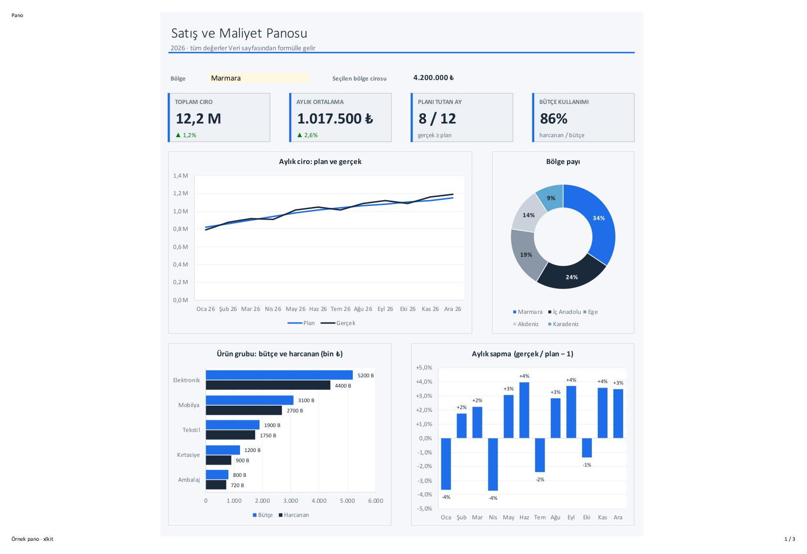
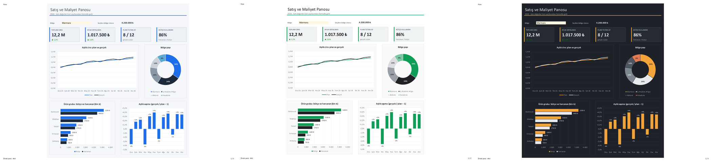

# Claude Excel Skills

Claude Code için üç skill'lik bir set: Excel'de profesyonel **panolar**, **grafikler** ve **tutarlı tasarım**
üretir. Ortak bir Python kütüphanesi (`xlkit`) ve çalışan bir pano şablonu içerir. Her kural Microsoft
Excel'de PDF'e alınıp görüntüden doğrulanmıştır.

*A set of three Claude Code skills for building professional Excel dashboards, charts and styled workbooks
with openpyxl. Turkish-first documentation; every rule was verified by rendering in Microsoft Excel.*



## İçindekiler

- [Skill'ler](#skiller)
- [Gereksinimler](#gereksinimler)
- [Kurulum](#kurulum)
- [Kullanım](#kullanım)
- [Örnek pano](#örnek-pano)
- [Örnek dosyalar](#örnek-dosyalar)
- [Dosya yapısı](#dosya-yapısı)
- [Bilinen sınırlar](#bilinen-sınırlar)
- [Lisans](#lisans)

## Skill'ler

| Skill | Ne zaman devreye girer | İçerik |
|---|---|---|
| [`excel-design-system`](skills/excel-design-system/SKILL.md) | Tema, renk, yazı, tablo, KPI kartı, Türkçe sayı/tarih biçimi, baskı | Tasarım kuralları, tema tokenları, `xlkit.py` |
| [`excel-charts`](skills/excel-charts/SKILL.md) | Grafik ekleme, seçme, renklendirme, etiket ve eksen biçimi, yerleşim | Grafik türü seçimi, tek tasarım kuralı, 14 ölçülmüş openpyxl tuzağı |
| [`excel-dashboard`](skills/excel-dashboard/SKILL.md) | Yönetim paneli, KPI sayfası, filtreli özet | Izgara, KPI kartı, filtre, gezinme, çalışan şablon |

Skill'ler birbirine dayanır: `excel-charts` ve `excel-dashboard`, `excel-design-system` içindeki
`xlkit.py` kütüphanesini kullanır.

## Gereksinimler

- [Claude Code](https://claude.com/claude-code)
- Python 3.10+ ve [uv](https://docs.astral.sh/uv/) (paketler çalışma anında yüklenir: `openpyxl`, `pymupdf`, `pillow`)
- Görsel denetim ve hesaplatma için macOS üzerinde Microsoft Excel (isteğe bağlı; olmadan dosya yine üretilir)

## Kurulum

Skill'leri kişisel skill klasörünüze kopyalayın:

```bash
git clone https://github.com/hazarvolga/claude-excel-skills.git
```

```bash
cp -R claude-excel-skills/skills/* ~/.claude/skills/
```

Yalnız bir projede kullanmak için `~/.claude/skills/` yerine projenin `.claude/skills/` klasörüne kopyalayın.
Claude Code yeni oturumda skill'leri kendiliğinden tanır.

## Kullanım

Claude Code'a doğal dille isteyin; uygun skill açıklamasından seçilir:

- "Satış verisinden 4 KPI kartlı, filtreli bir Excel panosu yap"
- "Bu kitaptaki grafikleri profesyonel hale getir, etiketler taşmasın"
- "Raporu kurumsal temaya göre biçimlendir, marka rengimiz #C8102E"

Kütüphaneyi doğrudan da kullanabilirsiniz:

```python
import os, sys
sys.path.insert(0, os.path.expanduser("~/.claude/skills/excel-design-system/scripts"))
import xlkit as xk

t = xk.tema("kurumsal", vurgu="C8102E")   # kurumsal | minimal | gece
xk.kpi_karti(ws, t, "B8", 5, "Toplam ciro", "=SUM(Veri!D7:D18)", "milyon")
xk.grafik_stili(chart, t, "Aylık ciro: plan ve gerçek", deger="milyon", ay_ekseni=True)
xk.yerlestir(ws, chart, "B12:P29")
xk.onizle("pano.xlsx", "onizleme")         # Excel -> PDF -> PNG, görsel denetim için
```

Tüm fonksiyonlar: [xlkit API](skills/excel-design-system/references/xlkit-api.md)

## Örnek pano

Şablon bir Veri sayfası ve bir Pano sayfası üretir: 4 KPI kartı, açılır listeli filtre, çizgi, halka,
yatay çubuk ve sapma grafiği. Pano üzerindeki her sayı formüldür.

```bash
uv run --no-project --with openpyxl --with pymupdf --with pillow python -I \
  skills/excel-dashboard/scripts/ornek_pano.py pano.xlsx minimal --onizle onizleme
```

## Örnek dosyalar

[`examples/`](examples) klasöründe üç temanın hazır panosu var. Dosyalar Microsoft Excel'de hesaplatılıp
kaydedildi; indirip açtığınızda değerler, grafikler ve filtre çalışır durumdadır.

| Tema | Excel dosyası | Görüntü |
|---|---|---|
| Kurumsal | [satis-maliyet-panosu-kurumsal.xlsx](examples/satis-maliyet-panosu-kurumsal.xlsx) | [PNG](examples/satis-maliyet-panosu-kurumsal.png) |
| Minimal | [satis-maliyet-panosu-minimal.xlsx](examples/satis-maliyet-panosu-minimal.xlsx) | [PNG](examples/satis-maliyet-panosu-minimal.png) |
| Gece (yalnız ekran) | [satis-maliyet-panosu-gece.xlsx](examples/satis-maliyet-panosu-gece.xlsx) | [PNG](examples/satis-maliyet-panosu-gece.png) |



Örnek verideki sayılar uydurmadır; yalnız yerleşimi ve biçimleri göstermek içindir.

## Dosya yapısı

```
skills/
  excel-design-system/
    SKILL.md
    references/  tema-tokenlari.md, xlkit-api.md
    scripts/     xlkit.py
  excel-charts/
    SKILL.md
    references/  openpyxl-grafik-tuzaklari.md
  excel-dashboard/
    SKILL.md
    references/  ornek-pano.png
    scripts/     ornek_pano.py
examples/        üç temanın Excel dosyası ve görüntüsü
docs/            README görselleri
```

## Bilinen sınırlar

- **Grafik veri etiketleri, Türkçe Excel:** Excel etiket biçimini bazı kitaplarda yerel sözdizimiyle okur
  (`#,##0.0,, "M"` etikette `5200000,00,, M` olur). Etiketin okuduğu hücrelerde yalnız `0 % + -` ve
  tırnaklı metin kullanın, ölçeği formülle yapın. Ayrıntı: [grafik tuzakları](skills/excel-charts/references/openpyxl-grafik-tuzaklari.md).
- Dilimleyici (slicer), pivot tablo ve makro openpyxl ile yazılamaz; filtreler açılır liste ve formülle kurulur.
- `onizle()` ve `excel_ile_kaydet()` yalnız macOS + Microsoft Excel ile çalışır. Excel sandbox'ı her yeni
  dosya ve klasör için bir kez izin ister.
- Doğrulama Excel for Mac 16 (Türkçe arayüz) ile yapıldı. Windows Excel'de görünüm küçük farklar gösterebilir.

## Sürüm notları

- **1.0.1:** `xk.dolgu()` artık `bgColor` da yazar. Önceden koşullu biçim kurallarında (`FormulaRule(fill=xk.dolgu(...))`)
  kullanılan dolgu Excel'de görünmüyor, yalnız LibreOffice'te görünüyordu. Hücre dolguları değişmedi.
- **1.0.0:** İlk sürüm.

## Lisans

[MIT](LICENSE)
